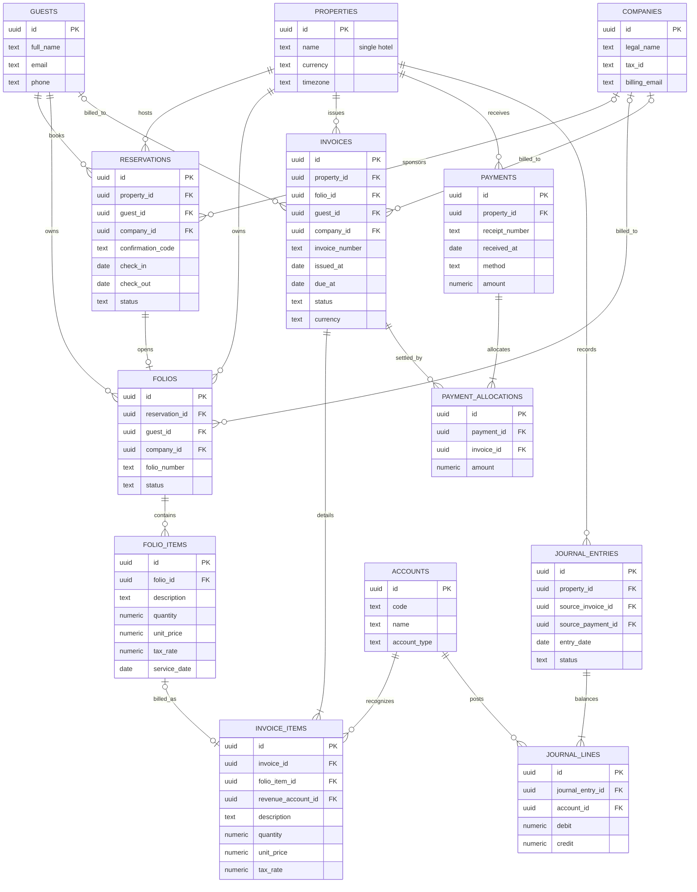

# ERD - Akuntansi Pendapatan dan Piutang Satu Hotel

Sistem ini melayani satu hotel. Tabel `properties` tetap menjadi record konfigurasi hotel dan kunci relasi untuk RLS, tetapi database membatasi tabel tersebut hanya memiliki satu baris; tidak ada pemilih cabang.

## Alur bisnis

1. Tamu membuat reservasi; reservasi dapat ditautkan ke perusahaan untuk kebutuhan corporate billing.
2. Pendapatan kamar dicatat sebagai baris folio selama tamu menginap.
3. Saat checkout atau proses billing, folio diterbitkan menjadi faktur. Faktur menyimpan snapshot pelanggan, mata uang, pajak, tanggal jatuh tempo, dan rincian pendapatan.
4. Faktur yang belum lunas menjadi piutang usaha. Penerimaan kas dapat dibayar sebagian atau penuh dan dialokasikan ke satu atau beberapa faktur.
5. Faktur dan pembayaran yang sudah diposting membentuk jurnal berpasangan: debit piutang/kas dan kredit pendapatan/pajak keluaran. Pembayaran mengurangi piutang tanpa mengubah pendapatan.

## ERD

## Aturan integritas utama

- Faktur ditautkan ke satu folio; folio dapat belum ditagih atau menghasilkan faktur.
- Penerima tagihan adalah tamu atau perusahaan. Snapshot nama/alamat tagihan tetap disimpan di faktur agar histori tidak berubah saat master pelanggan diperbarui.
- Jumlah faktur dihitung dari rincian: subtotal + pajak. Saldo piutang = total faktur - total alokasi pembayaran.
- Alokasi pembayaran tidak boleh melebihi nilai pembayaran, dan total alokasi ke faktur tidak boleh melebihi nilai faktur.
- Baris jurnal yang diposting harus seimbang (total debit = total kredit). Faktur yang diposting mendebit piutang serta mengkredit pendapatan dan pajak; pembayaran mendebit kas serta mengkredit piutang.
- Semua transaksi memiliki `property_id` yang menunjuk ke satu hotel. Nilai ini dipertahankan untuk integritas relasi dan RLS; bukan pemisah cabang.
- Akses pengguna dibatasi lewat keanggotaan hotel pada `property_members` dan kebijakan RLS.
